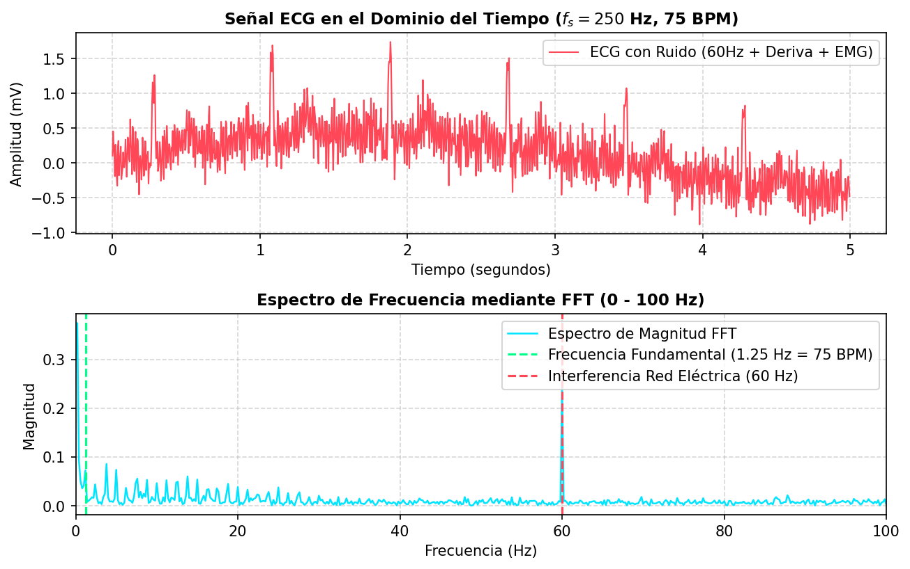
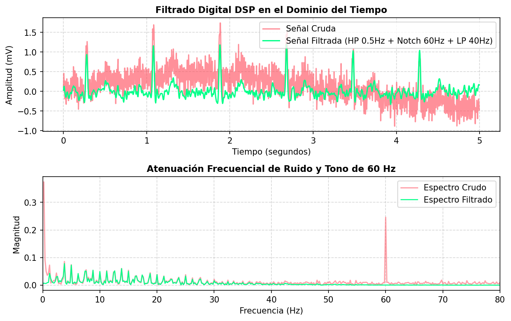

# 📈 Informe de Resultados y Análisis Frecuencial

En esta carpeta se encuentran las gráficas exportadas del análisis frecuencial mediante la **Transformada Rápida de Fourier (FFT)** y la aplicación de filtros DSP sobre la señal sintética de ECG.

## 🖼️ 1. Dominio del Tiempo vs. Dominio de la Frecuencia (`ecg_time_and_fft.png`)

### Interpretación Teórica:
1. **Pico Fundamental a 1.25 Hz:** Corresponde a la frecuencia cardíaca de 75 BPM ($1.25\text{ Hz} \times 60 = 75\text{ lpm}$).
2. **Armónicos Secundarios (2.5 Hz, 3.75 Hz, 5.0 Hz):** Originados por las componentes de rápida variación temporal del complejo QRS.
3. **Pico Agudo a 60 Hz:** Representa la interferencia electromagnética de la red de energía.

---

## 🧹 2. Desempeño del Filtrado Digital DSP (`ecg_filtering_analysis.png`)

### Relevancia Biomédica:
* **Filtro Pasa-Altas (0.5 Hz):** Remueve la oscilación lenta provocada por la respiración del paciente (deriva de la línea base).
* **Filtro Notch (60 Hz):** Elimina el componente sinusoidal de la red eléctrica sin alterar la amplitud de la onda R.
* **Filtro Pasa-Bajas (40 Hz):** Atenúa las perturbaciones musculares (EMG) de alta frecuencia.
